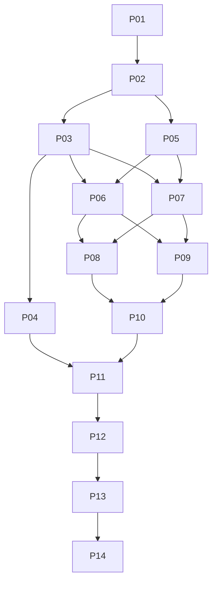

# AG1 Desktop implementation roadmap

Planning completed 2026-09-04. **Implementation has not begun.** This roadmap follows VISION, the repository research and the user's additional requirement to preserve the existing tuned llama.cpp setup. Execute phases only when instructed; the planning task stops here.

## Outcome and fixed requirements

Deliver AG1's agent/context/retrieval/task/memory/evidence/tool/recovery capabilities through a Dyad-derived React/TypeScript desktop, with Rust core ownership and a thin Tauri 2 host. Core works independently of React/Tauri; frontend state is a projection. Preserve intended AG1 behavior and fix B01–B04 with regression tests. Retain source evidence and the working reference until acceptance.

**Reuse the user's existing per-model llama.cpp engines and tuning throughout.** Three configured models resolve to three distinct existing builds; preserve their binaries/shared libraries, weights/projectors, profile precedence, effective arguments/environment and request semantics. No migration-triggered upgrade, rebuild, stock fallback or retuning. Details and binding L01–L08 are in [LLAMA_CPP_PRESERVATION](planning/LLAMA_CPP_PRESERVATION.md), with observed [runtime fingerprints](planning/evidence/llama-runtime-lock.json). Missing runtime identity blocks an equivalence claim; it does not authorize a replacement.

References remain `/home/alex/Projects/Cruzible` at `e30f0b4b238ee5618928bcd17b4571eb046e7038` and `vendor/dyad` at `fb17039bfd2adcac7d74b9c1178a3a3524df35b6`. Both stay read-only. The llama checkouts/config/weights also stay untouched. Research passed 491 selected tests; those results are reference evidence, not tests of this unimplemented plan.

## Architecture decisions

[DECISIONS](planning/DECISIONS.md) specifies packages, state/process lifetime, protocol, persistence, extension compatibility, preview and performance gates. The Rust library runs in the Tauri host; a future headless/CLI host composes the same services. External model/project/PTY/browser resources have explicit ownership. Closing presentation differs from quitting the application or crashing its host.

Use five principal packages—core, storage, platform, protocol and desktop—plus a thin CLI composition package when client parity arrives. SQLite transactional metadata/journal and immutable blobs replace heterogeneous TS persistence through a new-destination importer. Core defines ports; adapters depend on it. DTO generation keeps Rust/TS wire formats aligned. Commands/stream channels use identity, epochs, bounded queues, atomic snapshots and explicit replay gaps. No default daemon, mandatory Chromium shell or hidden TS parent runtime in the final product.

## Derived phase order

The 14 phases follow actual dependency and authority boundaries. Early UI is separated from shadow core work; storage precedes evidence, evidence precedes retrieval, provider/tool/context correctness precedes session integration, and complete integration precedes authority transfer.

| Phase | Depends on | Deliverable and objective exit |
|---|---|---|
| [P01 Reference/runtime lock](phases/P01-reference-and-runtime-lock.md) | Research | Executable pinned reference, child fixture inventory, exact runtime manifests, provenance ledger and gate runner |
| [P02 Protocol/core boundary](phases/P02-protocol-and-core-boundary.md) | P01 | Typed core ports, generated Rust/TS schema, real fake host; ordering/reconnect/approval/limits tests |
| [P03 Platform services](phases/P03-platform-services.md) | P02 | Explicit workspace/files/Git/process/PTY; CAS/path/ownership/reaping tests |
| [P04 TS bridge/desktop](phases/P04-typescript-bridge-and-desktop.md) | P03 | Usable real AG1 desktop with guarded existing TS runtime, narrow defect patches, approved visuals and early preview proof |
| [P05 Storage/import](phases/P05-storage-and-import.md) | P02 | Lossless versioned import/export, branch/artifact closure, corruption/crash tests; B02/B04 corrected |
| [P06 Providers/llama](phases/P06-providers-and-preserved-llama.md) | P03,P05 | Provider child parity, endpoint scheduler, safe lifecycle and exact per-model launch plans; zero backend replacement |
| [P07 Task/evidence](phases/P07-task-and-evidence-state.md) | P03,P05 | Task/memory/provenance/evidence APIs; B03 raw snapshot correction |
| [P08 Retrieval/context](phases/P08-retrieval-and-context.md) | P06,P07 | Deterministic retrieval/episodes/compiler shadow replay with quality and budget gates |
| [P09 Tools/policy/resources](phases/P09-tools-policy-and-resources.md) | P06,P07 | Full selected tool semantics, approvals, resource/extension broker; B01 aggregate correction |
| [P10 Session/recovery](phases/P10-session-runtime-and-recovery.md) | P08,P09 | Complete isolated Rust runtime, mid-loop context barriers, recovery, subagents and mode policy |
| [P11 Project/native runtime](phases/P11-project-and-native-runtimes.md) | P04,P10 | Web/native/Tauri/Godot lifecycle/diagnostics/verification, truthful preview capabilities |
| [P12 UI/client parity](phases/P12-ui-and-client-parity.md) | P11 | All AG1 surfaces/actions, CLI/JSONL/SDK facade, extension/adjacent compatibility dispositions |
| [P13 Authority cutover](phases/P13-authority-cutover.md) | P12 | Rehearsed import/drain/switch/rollback; one Rust owner and verified unchanged tuned runtimes |
| [P14 Acceptance/package](phases/P14-release-and-long-horizon-gates.md) | P13 | Locally packaged candidate, provenance audit, per-model live and 8h/24h/platform/performance evidence |

Each phase is executable by a fresh model after reading its named documents and dependency reports. [Phase execution contract](phases/README.md) defines allowed directories, entry checks, evidence format, commands, rollback and handoffs. Proposed test/module paths are explicit future deliverables; no phase may assume an unbuilt predecessor exists.

## Authority and usable intermediate products

| Stage | Agent state/tools | Model admission/control | Frontend and rollback |
|---|---|---|---|
| Research/P01–P03 | Existing reference remains intact; only fixtures in new workspace | Existing user runtime untouched; fake processes only | Protocol/platform test harnesses |
| P04 | Guarded TS worker owns private session/task/memory/artifact/tool state | TS scheduler and per-model resolver; no Rust generation scheduler around it | Usable desktop; one executing workspace; drop host after drain without changing originals |
| P05–P12 | TS stays executing authority; Rust reads captures and writes isolated shadow/test destinations | TS owns active endpoint; Rust uses fakes or separately reserved sequential canaries | Desktop remains usable; Rust isolated product gains complete features |
| P13 | Drain, snapshot/import, revoke TS and commit one Rust authority | Verify/adopt only proven control or restart owned process with same runtime plan; external services stay external | Reconnect with new instance/epoch; tested export/checkpoint rollback |
| P14 | Rust owns parent state/policy/runtime; optional extension host owns extension execution only | Preserved llama engines are external dependencies under explicit control policy | Packaged candidate; retain archived reference and rollback until acceptance |

No opportunistic TS/SQLite dual writes. No context IPC roundtrip for every source/result. No concurrent Rust shadow mutation or generation against TS's workspace/endpoint. Branch history, Git history, tool mutations and native runtime state remain distinct.

## Coverage, corrections and compatibility

[COVERAGE](planning/COVERAGE.md) assigns **all 85 capabilities, 30 invariants, four confirmed defects and eight llama requirements** to delivery/tests; [coverage.json](planning/coverage.json) is the machine-readable ledger. P01 expands broad provider/tool/format/client families into concrete child fixtures; P14 requires actual evidence for them. Every high-risk active row has both a success trace and a failure fixture before reference retirement.

B01 aggregate result budgeting is guarded in P04, implemented in P09 and integrated P10. B02 corrupt memory and B04 fork artifact closure are guarded P04, fixed in P05 and tested through P13. B03 source text/hash identity is guarded P04, fixed P07 and verified in retrieval P08. D01 unsafe PID/port ownership and D03 specialized write durability are mandatory platform/tool hardening. Old defective output is not the target golden result.

Absent CV algorithms and removed autonomy are not resurrected. Partial DAG/MCP exports remain documented reference APIs; actual textual workflow behavior is preserved. Lit web-ui, Slack mom and pods remain separate reference clients with explicit compatibility status; they are not silently dropped or declared ported. Skills/templates and supported JS extension APIs remain available through core resources and an optional bounded extension broker, without preserving a hidden TS AgentSession. Core mode policy migrates; terminal rendering need not.

## Data migration and reference retirement

P05 imports frozen original formats, opaque records, IDs, cursor keys and complete authorized artifact closure into a new destination. Store raw originals and hash manifests. Blobs publish durably before DB references; corruption has an explicit retained recovery state. P13 rehearses interruption at every transfer boundary, revokes old execution, switches one complete ownership bundle and tests rollback/export before real cutover. Unsupported downgrade must stop rather than lose unknown data.

Retain the immutable source, executable reference, launch/profile fixtures and exports through P14. Retire the TS agent from the default package only after complete Rust integration; optional JS extensions or project Node tools are separate dependencies. Retiring the reference from active use never means deleting the user's original repository, runtime builds or models.

## Measurements and remaining evidence tasks

| Evidence task | Owner | Method / decision gate |
|---|---|---|
| Effective tuned runtime identity | P01, verified P06/P13 | Resolve loader closure/weights/projector/argv/private env/request settings; hash, compare per model; unknown facts block live equivalence |
| Dyad and bridge visual/idle baseline | P04 | Supported pinned Node/native build, matched packaged scenarios on real display; original source inspection alone cannot pass |
| Provider live compatibility | P06/P14 | Fake fixtures for every retained family, then credential-dependent canaries; pending live providers listed explicitly |
| Native preview and OS process feasibility | P04/P03/P11 | Isolated webview/controlled children/native targets on each OS; unsupported capabilities explicit |
| Extension API inventory | P01/P09/P12 | Actual exports/callers and fixture hosts; supported/unsupported API matrix, no hidden whole-agent compatibility |
| Storage durability/import | P05/P13 | Faults at blob/DB/ack/import boundaries; cursor/branch closure and lossless rollback |
| Per-model performance/quality | P06/P13/P14 | Same three existing backends/configs, sequential prompts/cache conditions; tool/reasoning/TTFT/prefill/decode/VRAM/draft metrics |
| Long-duration/platform/package | P14 | 8h/24h, exact quality gates, matched all-process shell metrics, SBOM/notices and installer/update runtime noninterference |

No live endpoint availability, GPU performance or packaged desktop result is invented. Linux is first for the currently configured tuned ELF runtimes. Windows/macOS shell support can be tested independently, but tuned-local-runtime parity there needs separately authorized compatible builds, not substitution.

Adopt performance gates from DECISIONS/PERFORMANCE_BASELINE: ≥30% lower shell idle RAM and ≥50% smaller shell install versus matched Dyad; <0.5% one-core idle CPU; startup p95 <1.5s excluding model load; display lag p95 <50ms; no >10% equivalent core p95 regression; bounded queues and zero owned-process leaks. Qualify noise/durability differences, include all processes and reject quality loss regardless of speed.

## Completion criteria

Planning is complete when references/phase dependencies/coverage resolve, single-writer and llama preservation rules are explicit, every phase has concrete tests/exit/rollback/handoff, and bounded unknowns have an owner and gate. See `planning/evidence/plan-validation.json` for structural checks; these do not execute implementation tests.

Implementation is complete only when P14 has real accepted evidence for the advertised capability/platform set, confirmed defects are corrected, long-horizon quality and performance pass, provenance is clear and L01–L08 hold. A missing live/platform check stays pending. No source rewrite, product scaffold or phase execution was performed during this planning turn.
