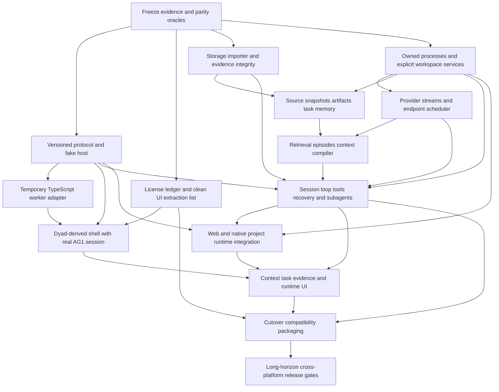

# Dependency graph and migration constraints

Labels below are work packages, not roadmap phases. The next planning instance must derive phases from them and may split/merge coherent packages. A phase cannot assume that a proposed module or protocol has already been built.

The graph describes logical dependencies. Some Rust provider/context work can run in shadow while the real UI uses TS. It does not authorize multiple independent writers or concurrent model generations.

| Package | Must consume | Produces | Objective gate / prevents |
|---|---|---|---|
| E: evidence/oracles | pinned AG1/Dyad, baseline reports, defect ledger | normalized fixtures, executable reference runner, coverage IDs | fixtures actually replay; no docs-only parity |
| L: provenance | file map, actual licenses, dependency closure | approved file/asset list and notices | no Pro/transitive restricted code, no copied branding/telemetry |
| P: protocol | actual SDK/RPC/Godot event/command shape | schema, generated types, fake transport, snapshot/sequence/approval contract | ordering/reconnect/idempotency tests before real UI |
| B: bridge | P, isolated reference build, explicit lifecycle contract | supervised TS worker with one active execution owner | prompt/tools/cancel/resume/approval drain; no production-reference mutation |
| U1: presentation shell | L,P,B | React shell/router/themes/project-chat-files views | real session through bridge; licensed visual/interaction scenarios |
| S: persistent foundation | E, reference formats | importer/exporter, journal/blob/cursor/lease/memory contracts, fault recovery | idempotent import; unknown records retained; B02 regression fixed |
| O: platform | E, process/path identity rules | owned process handles, PTY, fs/Git/search, secret ports | reaping/PID reuse/path/CAS tests; no unrelated process kill |
| V: inference | O,P/E stream fixtures | provider adapters, endpoint scheduler, model runtime supervision | stream/usage/cancel/health parity; exactly one strict local owner |
| C1: evidence state | S,O | byte-consistent source snapshots, task/memory/artifact APIs | B03 race fixed; provenance/freshness and migrations proven |
| C2: context policy | C1,V for isolated episode/summary calls | compiler, retrieval, episodes, prefix/overflow admission | deterministic quality/replay equivalence and bounded cost |
| R: execution | S,O,V,C2,P | session actor, tool policies, compaction/retry, queues/subagents, client-independent decisions | full fake-model tool-loop replay including races, B01 correction |
| N: runtime targets | O,R,P + existing Godot/check contracts | web/native/Tauri lifecycle/diagnostic adapters | native targets not URLs; run/build/stop and evidence gates |
| U2: observability | U1,R,N | task/context/evidence/runtime drawer, diffs/approvals/model health | all state core-owned, reconnect accurate, no render blocking |
| X: authority cutover | S,R,U2,L, explicit extension/API decisions | import checkpoint, one Rust authority, rollback/export, package | no hidden TS agent dependency in final target; notices/deps verified |
| G: release evidence | X and hardware/platform fixtures | cross-platform smoke, long-horizon, performance/crash reports | all parity IDs accounted for; no unsupported performance claims |

## Ordering rules that must appear in ROADMAP

1. Capture reference traces before replacing any subsystem; normalize IDs/clocks only, not distinctions that conceal semantic drift.
2. Implement artifact integrity and source snapshot identity before claiming fresh retrieval or compiler parity.
3. Preserve branch journal/task-state ordering before adding concurrent tool results or multi-session execution.
4. Establish provider cancellation/terminal semantics before adding recovery replay; establish recovery epochs before model/session switching.
5. Implement a model scheduler once per endpoint owner. During bridge migration, the TS scheduler remains authoritative until an explicit handoff; Rust must not separately schedule inside the same generation.
6. Implement native process ownership before model ejection/project stop; do not port port-killing helpers as ownership.
7. Introduce UI via a real adapter early, but keep core migrations testable without UI. Do not wait for every Rust subsystem before showing the visual target.
8. Transfer persistence authority only at a quiescent checkpoint with validated migration/rollback. Shadow reads are allowed; opportunistic dual writes are not.
9. Move mode-owned addenda/completion/approval rules into the new core with mode parity tests before removing the TS modes.
10. Complete preview isolation/platform feasibility before promising native embedded preview or CDP-level automation equivalence.
11. Resolve JS extension compatibility and adjacent packages explicitly before declaring complete Rust ownership. Retaining a temporary plugin host is different from retaining the entire agent runtime indefinitely.
12. Performance gates compare complete equivalent operations and all processes; disabling CV, browser automation or model supervision cannot be counted as a speedup unless the comparison names the scope difference.

## Authority transitions

| Transition | Writer before | Safe shadow work | Writer after / rollback |
|---|---|---|---|
| First desktop | TS session + existing formats | Rust protocol/fake host/UI projections | TS unchanged; drop new UI without affecting reference |
| Storage experiment | TS in isolated workspace | Rust importer reads frozen copy; verify IDs/blobs/branches | Still TS until explicit cutover; discard experimental destination |
| Context port | TS compiler/retrieval drives requests | Rust recomputes captured inputs and compares | Switch one coherent context path only with fixtures/metrics; toggle back at a session boundary |
| Runtime port | TS loop/model/tool owner | Rust fake-provider replay and supervised fake processes | Rust runtime takes ownership of imported session; TS worker exits, no dual execution |
| Final package | Rust runtime, optional explicitly scoped compatibility host | package/license/platform validation | Rust core product; rollback requires supported export/checkpoint, not reopening new DB in old TS |

The planner must choose whether context services cross the temporary worker boundary or remain shadow-only until Rust runtime cutover. Default recommendation: shadow-only for chatty compiler internals; avoid many IPC round trips per file/result. Coarse operations make intermediate products coherent.
