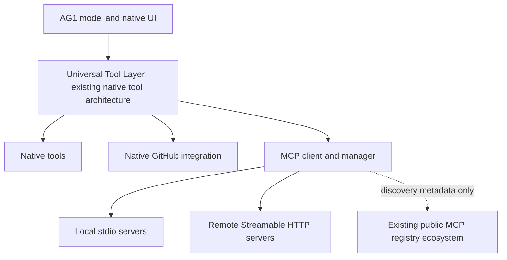

# MCP client integration — first-class management and discovery

Status: **core MCP integration complete and installed on 2026-09-13.** Phases A–F are accepted within the [documented compatibility boundary](../implementation/evidence/implementation-records/mcp/MCP-INTEGRATION-ACCEPTANCE.md). Restart AG1 to load the normal production release. The other feature tasks, real-model audit and duration programme remain paused.

## Historical implementation checkpoints

The following paragraphs record earlier checkpoints; their remaining-work statements are historical. B5 delivered shared execution/model discovery, B6 native desktop management, C1 manual credentials, and C2 OAuth. The final acceptance record above supersedes their completion status.

The [C1 manual-credential checkpoint](../implementation/evidence/implementation-records/mcp/MCP-AUTHENTICATION.md) is verified and installed: native private entry, manual remote tokens, local environment secrets, credential-bound connections and logout. It passes 253 selected Rust checks and seven MCP UI checks, unchanged baseline failure comparisons and final native workflows. OAuth, scoped trust and the rest of A–F remain unfinished.

The [C2 OAuth checkpoint](../implementation/evidence/implementation-records/mcp/MCP-OAUTH-PROGRESS.md) is verified and installed, including owned native sign-in/refresh/logout/error recovery, regression comparisons and normal production package/startup/payload validation. It supports public-client pre-registration. Scoped trust and the rest of A–F remain unfinished.

The [C3 scoped-trust workflow batch](../implementation/evidence/implementation-records/mcp/MCP-TRUST-PROGRESS.md) now implements native reviewed rules, durable scoped grants, revocation through the shared execution path and the desktop permissions editor. Focused manager/executor/UI checks pass. Read-only local containment and inactive native project-config import also pass focused checks. Full native acceptance remains; this development work is not installed. Per current user steering, broad verification is deferred while remaining features are implemented.

The [public discovery/setup batch](../implementation/evidence/implementation-records/mcp/MCP-PUBLIC-DISCOVERY.md) implements the GitHub registry client/cache, Discover UI and reviewed inactive remote/existing-local setup. Focused service/UI checks pass; input/media/delegation and combined final native/regression/production acceptance remain.

The [input continuation batch](../implementation/evidence/implementation-records/mcp/MCP-INPUT-CONTINUATION.md) adds bounded native choice forms for current-protocol waiting operations, with decline/cancel, identity and mode fencing. Media/delegation and final combined acceptance remain.

The [media/result batch](../implementation/evidence/implementation-records/mcp/MCP-MEDIA-PROGRESS.md) adds native raster previews, source/resource cards and original-response inspection through existing journal/artifact permissions. Final cross-feature/native acceptance and production packaging/install remain. Child agents deliberately do not inherit MCP connections; automatic delegated MCP access is outside this core completion boundary.

## 1. Product direction and completion boundary

**AG1 = MCP client + MCP manager + MCP discovery UX.** AG1 should be an exceptionally good consumer and manager of the existing ecosystem. Native integrations such as GitHub deliver maximum depth; MCP supplies breadth across external services without a separate native integration for each one.



“Universal Tool Layer” describes reuse and extension of AG1's registry, authority, executor and result contracts. It is not a second agent, inference loop, scheduler or independent tool-permission system. A registry is a discovery source, not an execution transport. MCP must not replace or reduce the completed native GitHub integration.

Normal users must be able to manage MCP entirely in AG1. Manual configuration and registry-guided setup lead to the same server records, permissions and detail views. No normal MCP workflow requires AG1 command-line flags.

**Core/MUST** requirements comprise protocol support, shared AG1 integration, authentication/trust, native management, public discovery/guided setup and acceptance in phases A–F below. Discovery is part of core product completion; a functional protocol adapter alone is not completion. Sections marked **Later** do not block core delivery. An unavailable registry dependency is an explicit product limitation/blocker, not permission to quietly drop Discover or build a registry backend.

## 2. Architectural fit: observed foundations and required changes

The following observations come from current source inspection. Older P08/P09/P10 guide introductions contain historical authority/status statements; current source, native runtime custody and completion records take precedence.

| Existing foundation | Reuse and MCP design obligation |
| --- | --- |
| [`Registry`](../product/crates/ag1-core/src/tools/registry.rs), [`Authorizer`](../product/crates/ag1-core/src/tools/approval.rs), [`executor`](../product/crates/ag1-core/src/tools/executor.rs) | Reuse validated arguments, active capability selection, registry/policy revisions, one-use authorization, durable intent and original/terminal result custody. Current origins are BuiltIn, Extension and TrustedHost; introduce explicit MCP provenance/adapter ownership without labelling untrusted server metadata as trusted native code. |
| [`NativeAdapters`](../product/crates/ag1-platform/src/session/adapters.rs), [`client/tooling`](../product/crates/ag1-platform/src/client/tooling.rs), [`client` composition](../product/crates/ag1-platform/src/client/mod.rs) | Add a native MCP execution capability below both UI and model entry points. The current dispatcher contains folder checks with a GitHub exception; account-scoped remote MCP must work without an attached folder through an explicit scope contract, without weakening file-tool grants or adding an unrestricted generic bypass. |
| [`schema`](../product/crates/ag1-core/src/tools/schema.rs) | Current validation deliberately rejects unsupported schema keywords. MCP schemas may exceed that vocabulary. Decide on a bounded compatible validator/adapter; never strip constraints, flatten unions or apply legacy scalar coercion silently. Unsupported tools stay inspectable with a clear non-executable reason. |
| [`session/context`](../product/crates/ag1-platform/src/session/context.rs), [`ContextStore`](../product/crates/ag1-storage/src/context.rs), [context guide](../product/crates/ag1-core/CONTEXT.md) | Integrate selective schemas with request preparation, canonical tool-prefix identity, context virtualization (CV), evidence leases and stale-request revalidation. Preserve complete tool-call/result pairs and raw custody before compression. Cache entries are not authority. |
| [`artifact_tools`](../product/crates/ag1-platform/src/artifact_tools.rs), [`artifacts`](../product/crates/ag1-storage/src/artifacts.rs), [`artifact_catalog`](../product/crates/ag1-storage/src/artifact_catalog.rs) | Reuse requester/branch-bound retained bytes, authenticated cursors, provenance, lazy reads and full-versus-preview semantics. MCP-provided IDs/URIs cannot mint AG1 artifact grants or native verification receipts. |
| [`session/extensions`](../product/crates/ag1-platform/src/session/extensions.rs), [`resources`](../product/crates/ag1-platform/src/resources.rs), [resource guide](../product/crates/ag1-platform/RESOURCES.md) | Reuse catalog publication/revision patterns and compatible presentation. Existing extension hooks are admitted host-account code; do not run MCP servers through that trust model or convert remote MCP resources/prompts into executable extensions or privileged system instructions. |
| [`CredentialBackend` and `SecretBytes`](../product/crates/ag1-platform/src/provider/auth.rs), [`extension_auth`](../product/crates/ag1-platform/src/extension_auth.rs), [`client/credentials`](../product/crates/ag1-platform/src/client/credentials.rs) | Reuse native secret custody, shared vault leases/CAS and logout tombstones. Existing provider OAuth/extension hooks do not establish generic MCP OAuth compliance. Add issuer/resource/server/account separation rather than reusing provider or GitHub credential keys. |
| [`FolderAccess`](../product/crates/ag1-platform/src/folder_access.rs), [`projects`](../product/crates/ag1-platform/src/projects/mod.rs), [runtime guide](../product/crates/ag1-platform/SESSION.md) | Reuse canonical folder identities, grant revisions, task/session ownership, cancellation, restart reconciliation and process custody. MCP workspace availability and actual filesystem/network access are different permissions. |
| [`Settings`](../product/apps/desktop/src/Settings.tsx), [`ReviewPanel`](../product/apps/desktop/src/ReviewPanel.tsx), [`native secret-entry precedent`](../product/apps/desktop/src-tauri/src/github_secret_entry.rs), [`ag1-protocol`](../product/crates/ag1-protocol/README.md) | React renders native projections; Tauri composes scoped commands/channels and native dialogs. Add MCP navigation and result adapters, not renderer-owned processes/credentials. Reuse or generalize private-entry mechanics without changing GitHub's approved behavior. |

### Proposed ownership, to refine in phase A

- **ag1-core:** tool identity/provenance, policy and approval bindings, normalized outcomes, context-selection contracts and task/runtime semantics. No concrete SDK/network/Tauri types.
- **ag1-platform:** a native MCP manager/service, SDK transport adapters, process ownership, scope resolver, connection/capability catalogs, authentication coordination and a read-only registry client. Share one authority-owning composition service; do not create one uncontrolled manager per React component or conversation.
- **ag1-storage:** durable user server definitions, nonsecret configuration, grants/revisions, private credential references and intent/result/artifact custody. Use existing transactional/blob/vault primitives. A metadata discovery cache is local client storage, not a registry backend.
- **ag1-protocol:** bounded typed commands, snapshots, health/progress events and errors with operation/scope/generation identities. Keep durable events separate from high-volume progress. Slow subscribers get gap/resnapshot behavior.
- **desktop/Tauri/React:** manager/detail/discovery/configuration surfaces, consent/private input and native result views. Manual tool tests and UI operations use the same native admission/effect path as the assistant.

Concrete module and DTO names are proposals, not APIs already delivered. Do not overhaul native GitHub or the model scheduler to fit MCP. Phase A must settle dynamic registry publication, validator compatibility, account-only scope, vault namespaces and lifecycle ownership before shipping model-facing execution.

## 3. First-class native manager

Provide an **MCP** destination within AG1's native navigation, with accessible wide/narrow layouts:

```text
MCP
├── Installed
├── Discover
└── Server details
    ├── Overview / health
    ├── Tools
    ├── Resources / templates
    ├── Prompts
    ├── Logs / diagnostics
    ├── Permissions / trust
    └── Configuration / authentication
```

“Installed” means a configured server available for management; it does not imply a local package was downloaded, that the server is connected or that any tool is approved.

| User action | Required behavior |
| --- | --- |
| Add manually | Choose Local or Remote, enter public configuration and private secret references, review exact target/scope/trust, then save inactive or explicitly activate. |
| Connect / Test connection | Review/authorize process start or remote connection and required credentials first. Test handshake/negotiation and allowed discovery only; never call a sample tool or read arbitrary resources just to test connectivity. |
| Disconnect | Close this managed connection and invalidate its live admissions/catalog lease. Retain configuration; make any remaining remote effect uncertainty visible. |
| Enable / Disable | Change persistent scope availability. Disabling blocks new calls immediately, invalidates pending approvals and drains affected work. It is distinct from temporarily disconnecting. |
| Edit configuration | Show the effective command/args/environment names/cwd or URL/auth profile and scope. Save atomically as a new revision; relevant edits invalidate old grants/admissions and require reviewed reconnection. Display secret placeholders, never stored values. |
| Remove | Stop/drain owned work and remove the selected definition/scope grants. Offer explicit removal of unshared credentials. Do not uninstall unrelated packages or erase retained conversation evidence. |
| Inspect | Show capabilities, errors, authentication, health and exact originating server without invoking a tool. Keep disabled/unavailable tools visible with reasons. |

### Local and remote forms

**Local:** executable/command, argument array, reviewed working directory, minimal environment plus explicit secret references, execution/runtime requirements and workspace availability. Display the effective launch, including a package runner's ability to download or execute code. No implicit shell interpolation or inherited credential environment. Paths/identities are resolved by native code at admission and revalidated at launch.

**Remote:** MCP URL, supported Streamable HTTP configuration, authentication requirement/profile, account identity when available, workspace availability and connection policy. Default to validated HTTPS. Explicit local/development or private-network endpoints need narrowly scoped native policy; discovery/redirects may not turn that choice into unrestricted access to other internal hosts. Unsupported authentication/configuration combinations get actionable manual guidance.

The same controls work for a manually added local PostgreSQL-like server, a remote service and a registry-derived definition. Names in UX examples describe use cases; they do not promise that a particular live listing, package or account is available.

### Server and tool detail

Each server MUST show AG1's stable identity, display name, configured origin/source, registry/package/version provenance if known, transport and actual endpoint/executable, enabled scopes, connection health, negotiated protocol revision, advertised versus successfully discovered capabilities, authentication/account status, trust policy, last refresh, recent errors and redacted logs. Configuration remains editable from this view.

Tool detail MUST show original server tool name, stable AG1 namespace/wire identity, description, complete bounded argument schema and output schema when provided, originating server, availability/reason, AG1 risk classification and its basis, server-supplied annotations separately, and resulting approval behavior. Users can inspect a tool and restrict it before the model can execute it. Resources/templates and prompts receive equivalent origin, arguments, availability and inspection views.

## 4. Discovery and guided setup

### Source strategy and research gate

Prefer the official MCP Registry as the authoritative upstream discovery source **where its architecture and usage contract support AG1's access pattern**. Research the current API/schema, host-app guidance, permitted use, search/pagination, caching, moderation/status semantics and uptime/rate limits before implementation; pin the selected interface and fixtures.

At this planning review, the official documentation describes a metadata registry rather than a package host, warns that it is in preview, and directs host applications toward downstream registries/marketplaces. Therefore direct querying from every AG1 installation is **not a settled design**. Select an existing compatible public downstream source with transparent upstream provenance if the official guidance remains; direct official access requires confirmed support. AG1 must not solve this by operating a registry backend. [Official Registry architecture](https://modelcontextprotocol.io/registry/about)

The currently documented aggregator interface includes paged/versioned metadata and expects restrained cached consumption; it does not provide a durability/uptime guarantee. Do not assume a full-text search API, exhaustive tool schemas or complete setup recipes are available. A bounded local index/search over supported metadata is a valid client-side fallback. Record source and retrieval time, explicit partial/offline state and cache policy. Revalidate all API/version assumptions in phase A/E. [Registry consumer guidance](https://modelcontextprotocol.io/registry/registry-aggregators)

### Core discovery UX

- Search/browse server records; distinguish local packages and remote endpoints, publisher/origin, description, version/status, setup/runtime/auth requirements and available documentation.
- Show **claimed capabilities from metadata** separately from **capabilities discovered from an approved live connection**. Missing tool listings mean “Connect to inspect,” not an invented capability list. Browsing details never starts a process or connects to an advertised endpoint.
- Display the exact package/executable/runtime/argument template or URL that Add would use. Registry presence, namespace provenance, popularity, icons and annotations never grant trust or prove code safety.
- Treat all metadata, Markdown, icons, links, schemas, argument templates and extension fields as untrusted. Bound parsing, length/depth, pagination, image fetching and cache size. Do not execute HTML, fetch arbitrary schema references or follow metadata-controlled URLs with credentials.
- Keep marketplace searches separate from private workspace content. Do not automatically upload source code, chat text or secrets as discovery queries. Label discovery network access/source.
- Show unavailable/deprecated/withdrawn records and actionable source errors. Stale cache cannot silently approve a changed launch target. Existing manual definitions remain manageable during a registry outage.

### Guided setup state machine

`Discover or Manual → Inspect → Add draft → Configure → Review activation → Authenticate if needed → Connect/test → Enable in selected scope`

The UI may combine screens where appropriate, but native authority boundaries remain separate. Adding a draft grants no execution or credentials. OAuth consent does not automatically enable model access; enabling a server does not automatically approve all tools.

Where metadata is sufficient, prefill validated fields and explain what the server provides, what runtime/authentication is required, where it will be available and which calls will ask for approval. Default to the current workspace when one is selected; “All workspaces” requires an explicit choice. When no project is open, offer an explicit general-chat/account scope or deliberate global availability.

“One-click” means fewer manual fields and a clear final review, never hidden software execution. For a local server:

1. Prefer an existing executable/runtime when it satisfies the reviewed recipe. Show resolved identity, args, working directory, public environment and secret variable names.
2. If a supported recipe needs package acquisition, separately disclose source, exact version/integrity information available, destination, runtime/dependency requirements and install-script/code-execution effects. Require explicit acquisition/activation review. Use bounded, owned operations and retain status/partial failure; never run an unreviewed `npx -y`/equivalent just to inspect capabilities.
3. Support a small documented recipe matrix where technically safe. Unsupported package ecosystems or missing runtimes receive exact manual instructions and return to the same connection form. Installing system runtimes or acting as a general package manager is outside scope.
4. Revalidate the selected record and effective launch before activation. Metadata/package/config identity changes invalidate prior approval; mutable tags or unverifiable dependencies must be disclosed, not represented as immutable pins. Never silently update installed code on reconnect.

The official Registry points to external package systems; supported metadata forms do not imply AG1 must implement every package manager. Confirm actual metadata and resolution behavior before selecting core guided recipes. [Package-type reference](https://modelcontextprotocol.io/registry/package-types)

## 5. Workspace scope, identity and user-visible trust

### Scope model

Persist a user-owned server definition separately from its grants: all workspaces, selected canonical projects/workspaces, general-chat scope where applicable, or disabled. Workspace configuration can reference an existing definition without copying credentials. Denial overrides availability, and a definition alone is never a grant.

Any detected/imported project MCP configuration is an inert, bounded proposal until the user reviews the exact command/URL, environment requirements and scope. Opening, cloning, indexing or checking out a repository must not activate it, start a package runner, resolve secret references or contact its endpoints. Core MUST provide bounded project-configuration intake for at least one explicitly documented format, saved as an inactive draft with source provenance and reviewed field mapping. Broad compatible-format import/export is a Later enhancement; the inactive-by-default rule applies to every intake path.

Model discovery, active schemas, requests, results and subscriptions must be filtered by current session/workspace, enabled grants, authenticated profile and connection/capability generation. Reopen/fork/navigation rechecks the effective scope; historical tool names or cached schemas do not regrant access. Account-scoped remote tools must not require a dummy writable folder.

Global configuration does not imply a shared process/session. Default to separate connection leases for workspace/security domains and credential profiles, especially for stateful local servers with a cwd or roots. Share only where isolation is established. Scope disable/cancel must not terminate another scope's legitimate operation; whole-server disable/logout must retire all affected leases. Persist one owning authority or use existing native fencing across desktop instances; never infer ownership from PID or endpoint availability.

### Binding and policy

Use a native server UUID independent of display name, registry name or server self-report. Bind executable/package identity or normalized endpoint, configuration revision, transport/negotiated revision, credential profile/generation and capability/schema digest to the native lease. Stable namespaced tool IDs must avoid native/GitHub/extension collisions and provider naming limits while preserving the original tool name. Removing/re-adding a same-named server does not inherit old approvals.

Approval binds this identity to exact call/arguments, policy and registry revisions, conversation/workspace/task scope, target/grant witnesses where applicable and expiry. Relevant edits, account changes, tool replacement or schema changes invalidate it. Publish a validated capability snapshot atomically; avoid half-updated registries and partial approval transfer.

| Product policy | Native meaning |
| --- | --- |
| Disabled / workspace denied | No discovery to that model scope and no new execution. Revoke pending admissions and settle existing work. |
| Restricted (default) | Ask before server calls unless the user explicitly permits a bounded, reviewed low-consequence tool/rule in this scope. Unknown risk remains ask/deny as appropriate. |
| Disable writes | Admit only tools/argument cases with a reviewed read policy; deny unknown/mixed/write/consequential operations rather than trusting a server's read-only annotation. |
| Allow approved write tools | Persist exact server/tool/schema/scope grants for explicitly selected non-consequential operations. Show revocation controls and re-review changes. |
| Trusted | A readable summary of explicit grants, not unlimited authority or a bypass of host, credential, scope or consequential-confirmation checks. |
| Consequential operations | Always require an exact fresh confirmation, including destructive, administrative, credential/access, paid or other high-impact effects identified by host policy. |

Show **AG1 classification**, **server assertion** and **user-approved policy** separately. Server annotations cannot safely prove read-only behavior. Reads can still disclose data or incur cost. A generic/mixed tool needs argument-aware policy where enforceable; otherwise treat it conservatively. Planning/read-only modes must not gain writes through MCP.

**Critical limit:** tool policy and workspace selection do not sandbox an arbitrary executable. Starting a local server itself runs code with its effective OS access, before tools are called. Phase A/C must define enforceable filesystem/network/process isolation and explicit launch permissions using existing native containment where compatible. Disclose any broader host-account execution mode and require deliberate opt-in; never label it filesystem-confined merely because a project is selected. MCP roots are protocol information, not an OS security boundary. Remote server behavior likewise cannot be guaranteed by annotations.

## 6. Shared tool execution and context/CV efficiency

### One native execution path

MCP tool calls enter the existing registry → argument validation → policy/approval → durable intent → adapter → retained original result → terminal journal/result path. UI manual execution uses that same contract, with native owner/scope even outside a chat. Do not introduce a renderer-only call route or a separate “MCP agent.” Native task state records progress, waiting for consent, failure, cancellation and uncertainty; a server cannot mark an AG1 task verified merely by claiming success.

Resolve origin and effective permission below dispatch. Retain original server output separately from post-hook projections. MCP results cannot forge native file-change/Undo receipts, current-source inspections, check results or runtime ownership. Preserve built-in/GitHub/extension behavior and the existing runtime scheduler.

### Lazy/selective discovery

The model should use MCP tools through ordinary AG1 tool semantics without special user prompting. **Do not inject the full server inventory or hundreds/thousands of schemas into every turn.**

1. Keep a compact, scope-filtered directory of available servers/capability groups and a small native discovery/search facility. Search cached approved catalogs without starting disabled/unreviewed servers or reading remote resources.
2. Return bounded matches with stable tool IDs, server origin, short descriptions, availability and schema revision. Retrieve full schemas only for selected tools.
3. Prefer validated selected definitions in the normal active tool set at a safe request-preparation boundary. Phase B must prove this against AG1's registry and runtime fences; any stable dispatcher fallback must still resolve and validate the exact inner schema and use the same approvals, not become an arbitrary JSON execution tunnel.
4. Keep deterministic tool ordering and canonical schema hashes; rebuild only the affected unsent model request when capability, grant, account or scope changes. Do not mutate a running request's meaning or evict a definition needed to settle its call/result pair.
5. Cache public registry metadata separately from private connected-server capabilities. Key private snapshots by native server/config/auth/scope/revision identities. Refresh through supported change notifications or bounded explicit refresh/reconnect; never execute against stale permissive data after a failed refresh.
6. Use existing CV/compiler budgets, artifact pointers and evidence leases for large schemas/results. Retain complete authorized originals before reduction, with honest truncation/availability and server/source provenance. Do not introduce a parallel vector store, hidden model router or second context compiler.

Resources/templates and prompts are part of the same scope/discovery model. List them lazily, validate template arguments, and perform content reads only under the relevant policy. A resource URI is not filesystem or network permission. Resolve it through its originating approved MCP server; fetching a returned external link or local path needs its own native grant. Prompt inspection/use is explicit; returned role labels/instructions remain untrusted content and cannot rewrite system policy or auto-execute embedded requests.

## 7. Authentication and private configuration

The manager MUST show whether authentication is required, unauthenticated/authenticating/connected/expired/revoked state, the bound server/resource and active account where reliably available, and clear Reauthenticate / Log out controls. If account identity is unavailable, say so rather than trusting a server-supplied label as verified identity.

- Reuse native secret/vault primitives, but implement MCP authorization through a dedicated issuer/resource-aware coordinator. Key credentials by native server/auth profile, validated issuer/resource/audience, account and granted scopes; an origin match alone is insufficient. Never resolve another server's, provider's or GitHub's credentials as fallback.
- Implement specification-compatible OAuth discovery, supported client registration/metadata strategy, PKCE/state, callback binding, audience/resource validation and scoped consent. Check redirect chains, DNS/network destinations and metadata documents; reject unexpected origin changes, token passthrough, credential-bearing URLs and private-network escalation.
- Launch browser authorization through native control. Bind callbacks to the exact pending operation/server and expected loopback or app redirect mechanism; prevent spoofed/replayed callbacks. Do not relay authorization codes/tokens in generic renderer command arguments or logs.
- Refresh under shared vault lease/CAS, with expiry, cancellation and logout tombstones. Late refresh/login must not resurrect revoked credentials. Distinguish local logout/token removal from confirmed upstream revocation; provide provider guidance when remote revocation is unavailable.
- Local environment secrets and supported manually supplied remote tokens use native private entry and opaque references. The renderer edits public values and secret names/references only. Inject approved secrets only into the intended child or authenticated request; disclose that the destination receives those secrets. Do not place secrets in argv, ordinary tool/schema metadata, artifacts, model context or unredacted diagnostics.
- Authentication requests from server content, prompts or input forms do not authorize reading arbitrary secret references. Route only validated supported authentication/private-input flows; reject credential harvesting through generic elicitation. Do not promise secure locked OS/GTK input buffers merely because the UI masks text.

Authentication consent, activation consent and tool/action grants are distinct. Unsupported auth flows must fail clearly and remain inspectable. Phase C revalidates current authorization requirements and implements negative fixtures; existing provider OAuth success is not evidence of MCP OAuth correctness. [Authorization reference](https://modelcontextprotocol.io/specification/2025-11-25/basic/authorization)

## 8. Protocol, lifecycle and bounded operation

Retain both stdio and Streamable HTTP. At implementation start, pin SDK/compiler/dependency/licence compatibility and write a tested revision/capability matrix. Current and deployed legacy revisions need explicit adapters for negotiation/initialization, framing, discovery, errors and shutdown; do not combine incompatible behaviors. The official versioning page and Rust SDK were inspected during this planning pass, but supported versions/features must be revalidated and tested against the exact SDK commit/release selected in phase A. [Versioning](https://modelcontextprotocol.io/specification/versioning), [Rust SDK](https://github.com/modelcontextprotocol/rust-sdk)

Carry forward `2026-07-28` and `2025-11-25` as initial compatibility targets. Test discovery/stateless/multi-round-trip behavior separately from legacy initialization/session behavior as specified by each selected revision. Legacy standalone HTTP+SSE is not interchangeable with SSE carried by Streamable HTTP; support only explicitly selected and tested transports. Optional features are not enabled just because the SDK exposes them. Audit SDK defaults for automatic retries, stale-cache fallback, redirects, environment inheritance and schema-controlled routing headers; they must not bypass AG1's authority, privacy or freshness rules.

### Operation and connection state

Keep persistent availability (`enabled/disabled`), authentication and transient connection health separate. Display states such as stopped, starting/connecting, negotiating, ready, waiting for authentication/input, degraded, stopping, crashed and incompatible, with last success/error and the next useful action. A healthy transport does not prove a tool succeeded; a schema mismatch can make one tool unavailable without hiding the whole server.

Local process ownership uses authenticated native child/process-group custody, bounded pipes, redacted stderr, deadlines and actual wait/reap. Stop/quit/crash reconciliation must handle descendants and partial startup, not just close the renderer. Inspect SDK process handles before adopting its convenience launcher: dropping an SDK object is not proof of owned process cleanup.

Remote streams need bounded connect/read/idle/operation deadlines, backpressure, response/framing validation, rate/error guidance and owned cancellation. Use negotiated session/resumption semantics only where supported; credentials and session identifiers never cross origin/identity boundaries. Reconnect is bounded and visible, refreshes capability leases, and does not replay tool calls. A disconnected remote may still be executing an accepted call; report that uncertainty.

Persist an admitted intent before any potentially effecting call. Track not-sent, in-flight, waiting-input, completed, application-error, cancelled and unknown/interrupted outcomes separately from effect certainty. A transport error or application error can follow partial effects. On restart, inspect/reconcile unfinished intents; never automatically execute them again. Return one terminal result to the native session and retain late events only under explicit diagnostic policy.

For supported multi-round-trip input requests/legacy elicitation, show bounded user-facing consent/forms, bind continuation state to the originating operation/server/account/scope, cap rounds/bytes/time, and support decline/cancel. Protocol continuation of an explicitly waiting operation is distinct from retrying an uncertain write. Do not echo opaque state to a new server, expose it in model context or automatically perform requested sampling/roots/credential actions. Unimplemented optional requests receive explicit protocol-appropriate refusal.

### Resource budgets (required design deliverable)

Before shipping each boundary, choose numeric configurable-within-safe-ceilings limits and publish tests for them. This plan does not claim one frame size fits all servers. Budget at least: configured servers and active processes/connections; startup/operation/shutdown time; concurrent requests and queued operations; frame/decompressed bytes and JSON depth/nodes; schemas/catalog entries/pages; SSE buffering/events; input rounds; stdout/stderr/log disk retention; result/artifact bytes and image pixels; registry cache/search work; and aggregate host memory/disk/process consumption.

Bounds must apply before full allocation/decode and across connections, not only per message. Exceeding a limit yields a visible diagnostic and an honest incomplete/unknown result as appropriate. Do not silently discard output and call it complete, hold the native session owner/UI thread while awaiting network/input, or exhaust the provider scheduler with unrelated server work.

## 9. Result rendering and diagnostics

| Result | Native presentation and custody |
| --- | --- |
| Text / structured data | Readable summary and bounded literal source/JSON view; preserve valid revision-specific scalar/array/object shapes rather than assuming every structured result is an object. |
| Images | Existing bounded decoder and authenticated artifact path; enforce MIME/byte/pixel limits before display. Unknown formats stay downloadable/unsupported with a clear reason. |
| Resources, templates and links | Source-labelled cards and lazy content inspection; distinguish a resource reference from retained bytes. No automatic external navigation, download or local-file dereference. |
| Large/mixed outputs | Preserve ordered content blocks and full retained originals within budgets; summaries and authenticated pages feed CV. Clearly label incomplete retention and provide copy/download where authorized. |
| Errors | Separate transport/protocol failure from server application failure and uncertain effects. Successful HTTP/JSON-RPC delivery must not turn `isError` or malformed output into success. |

Use existing chat/output/artifact/Review surfaces. Server-supplied HTML/SVG and prompt-like text remain inert; native verification/Undo is available only when independent AG1 evidence establishes it. Disconnect drops pending private results and live caches; retained historical evidence follows existing branch/session ACL and retention rules, not automatic destructive deletion. Fork/export must not broaden private-server access or copy credentials.

**Logs/diagnostics MUST be a user-facing core view**, focused on AG1-connected servers rather than a developer IDE. Provide safe codes and actionable messages for missing executable/runtime, start failure, auth expiry/failure, protocol mismatch, malformed frame/result, tool application failure, dropped connection, crash, timeout, schema/capability change and quota exhaustion. Link errors to server, operation, timestamp, health state and possible recovery; do not silently make tools disappear.

Bound and redact diagnostics at capture as well as display/export. Default to metadata/status/timing, not raw arguments, private resource bodies, headers, tokens or opaque input state. Strip terminal controls and treat log content literally. Any optional diagnostic export is user-selected, permission-checked and sanitized; redaction is not a claim that arbitrary logged data is public. Server stderr is untrusted and can contain supplied secrets. Successful refresh does not erase historical failed-run evidence.

## 10. Implementation phases and exit gates

All security and scope boundaries apply from the first slice. Phase A may use only owned fixtures and least-privilege test credentials; it must not expose an unauthenticated/unrestricted production call path while waiting for phase C. Final hardening supplements tests in every phase, not a deferred security pass.

| Phase | Bounded deliverable | Required exit evidence |
| --- | --- | --- |
| **A — Protocol and native foundation** | Fresh SDK/revision/registry research; architecture decisions for registry/schema/scope/vault/process ownership; owned stdio and Streamable HTTP; revision adapters; tools/resources/templates/prompts; errors, input continuation, cancel/shutdown and initial budgets. | Exact pinned dependency/licence report; protocol capability matrix; local/remote fixtures; unsupported-revision/schema refusals; bounded frame/input and child teardown tests. No production activation bypass. |
| **B — AG1 integration** | Native adapter and origin/identity binding; ordinary executor/task/approval path; atomic catalog refresh; lazy discovery and selected schemas; context/CV/artifacts; shared native result DTOs; workspace/general-chat filtering. | UI/model-independent service contracts; capability change during approval/queued preparation; scoped artifacts/provenance; 1,000-tool context-budget fixture; existing native/GitHub regressions. |
| **C — Authentication and trust** | OAuth/private config and namespace-separated vault; user-visible grant semantics; read/write/consequential policy; scope revocation; effective local execution access/containment; startup and credential-generation fencing. | Owned OAuth server and hostile discovery/callback/SSRF fixtures; logout/refresh races; cross-server credential refusal; imported-config zero-execution; trust-mode enforcement and containment/disclosure evidence. |
| **D — Native MCP manager** | Installed/detail navigation; manual add/edit/remove; enable/disable/connect/disconnect/test; tool/resource/prompt inspection; private input/auth flow; health/logs/permissions/configuration. | Actual Tauri/WebKit wide/narrow workflows for local and remote fixtures, including general-chat/account scope; accessible input/focus; no extra prompts/secret leakage; disable/remove/quit cleanup and truthful error recovery. |
| **E — Discovery and guided setup** | Existing registry source adapter; search/browse/cache; claimed-versus-discovered metadata; inactive Add drafts; reviewed supported setup recipes and manual fallback; auth and scope activation through D. | Recorded current source contract and setup matrix; owned registry fixtures; hostile/missing/stale/withdrawn metadata, offline/rate-limit behavior; zero process/credential effects during browse; exact launch/URL/version review and activation checks. No AG1 registry service. |
| **F — Hardening and acceptance** | Complete cross-feature threat/failure matrix, native discovery-to-use/manual workflows, runtime/resource/leak checks, regression and release build. | Acceptance scenarios below pass on the exact candidate; limits and failures recorded; normal production package/startup/install verification once implementation is authorized; no live-account/paid effects without specific authority. |

Implement and verify one bounded slice at a time; update a capability/evidence ledger as actual behavior lands. When the user resumes implementation, follow the shared major-checkpoint production build/install preference and give a short remaining-work/effort summary. A–E may each contain multiple checkpoints. Completing MCP does not authorize starting [chat cleanup](03-CHAT-CLEANUP.md), [combined verification](04-FINAL-VERIFICATION.md) or the broader P14 release programme beyond the user's resumed scope.

## 11. Concrete acceptance and adversarial matrix

The final acceptance record MUST map every core requirement to implemented/tested/unsupported status, exact source/candidate/SDK/protocol identity and evidence. Required scenarios include:

| Scenario | Observable pass condition |
| --- | --- |
| Discovery to useful model action | With an owned registry listing and service fixture representing a Sentry-like use case: MCP → Discover → search → inspect → Add → authenticate → enable for current workspace. A user asks “Check Sentry for errors related to this code.” Normal AG1 discovery selects the relevant tool, applies policy, calls the intended fixture and renders a source-labelled result without bespoke MCP prompting. No real Sentry listing/account is assumed. |
| Manual local setup | Enter command + argument array + public environment/private references; inspect launch/access; connect/test; inspect tools/resources/templates/prompts; call an approved capability; disconnect/disable/remove and quit. No hidden package install or shell expansion; owned children are reaped. |
| Manual remote setup | Enter a fixture MCP URL, complete required auth, inspect negotiated capabilities and use an approved tool/resource/prompt. Expiry/reauth/logout/error recovery is visible and uses the same manager as discovery setup. |
| Inert discovery/import | Search/detail/Add draft and opening an MCP-config-bearing project cause zero server process starts, package executions, token resolutions or advertised-endpoint calls until explicit review/activation. Registry fetches are counted separately. |
| Workspace and identity isolation | General-chat scope works without a dummy project. Project A enables a server; B cannot discover/call it or recover its private results. Global configuration does not transfer cwd/state/secrets. Same-name server/tool substitution, schema/config/account changes and revoke during approval reject stale admissions. |
| Trust policy | Restricted defaults ask; explicit read/write grants apply only to their bound scope/tool/schema; Disable writes denies unknown/mixed writes; consequential operations still require fresh confirmation under Trusted/permissive local settings. |
| Context/CV scale | A fixture with at least 1,000 tools exposes only a bounded summary/discovery surface and selected schemas. Record schema count, bytes/token estimates and aggregate budgets per outgoing request. Inactive schemas do not grow every turn; eviction preserves complete call/result history and provenance; capability changes rebuild stale unsent requests. |
| Mixed/large/error output | Text, structured scalar/array/object, image, resource link, missing/oversized data, invalid MIME/schema and application errors remain bounded, literal, scoped and honestly labelled. Full authorized retained bytes remain retrievable; no forged native check/Undo authority. |
| Lifecycle/uncertainty | Cancel before send, during stream and during input; drop network; crash child; interrupt after possible effects; restart AG1. One terminal outcome, no automatic replay, bounded recovery/reconnect and no leaked descendants/streams/leases. Cancel one workspace without disrupting an unrelated lease. |
| Credential boundary | Wrong issuer/resource/audience, hostile redirect/DNS target, replayed callback, late refresh after logout, swapped account and server-requested foreign secret all fail. Scan renderer state, provider messages, logs and exports for owned synthetic secrets. |
| Hostile server/metadata | Prompt injection, misleading annotations, schema bombs/unsupported keywords, external references, malformed/truncated/duplicate-ID frames, SSE floods, stdout/stderr floods, excessive input rounds, hanging/crashing processes, changed capabilities and private-network escalation are rejected or bounded without partial unsafe catalog publication. |
| Registry/setup failure | Missing metadata/runtime, incompatible recipe, changed package/version, malicious args/URLs/icons, unavailable/rate-limited source and stale/withdrawn listing produce explicit states. Manual setup stays usable. Acquisition cancellation preserves known partial state without unreviewed retry or deleting unrelated packages. |
| Native product quality | Installed/Discover/detail/tools/resources/prompts/logs/permissions/configuration work at wide/narrow sizes with keyboard/focus, loading/empty/error states and preserved drafts. Inspect screenshots of real native windows, not only DOM assertions. |

Owned protocol/OAuth/registry fixtures and scripted model providers establish deterministic behavior. The separately scoped bounded real-model audit can verify tool selection and conversation quality once authorized/resumed; it does not substitute for protocol/security tests. Distinguish real inference from fixed responses and DOM input from physical input. No eight-hour run, live private-server disclosure, paid action or real-account mutation is implied by this plan.

## 12. Later enhancements — explicitly non-blocking

- Update notifications/version comparison, favorites, recently used servers, richer categories/tags and curated recommendations. Core still records initial version/source identity and detects changes; automatic updates are not required.
- Workspace MCP profiles and broader import/export of compatible configuration formats. Core still requires scoped availability and inactive-by-default handling of any imported config it accepts.
- User-configurable registry sources, private organization registries and organization policy. Core selects an existing public source; no registry backend is operated by AG1.
- Richer diagnostics, opt-in usage statistics and developer conveniences beyond connection/call troubleshooting. No telemetry of private payloads by default.
- Optional subscriptions, long-running protocol tasks, sampling and roots only after separate complete permission, runtime, context and test designs. Minimal notification/input support required by the selected core protocol must still be correct; unsupported requests are explicit. Sampling must use AG1's existing scheduler and user authority, never a second agent.
- Additional package recipes, transports, protocol revisions and platform-specific private-input/containment providers after their compatibility and ownership tests exist.

## 13. Explicitly out of scope

AG1 will not build a public MCP registry backend, MCP hosting/cloud infrastructure, a competing package ecosystem, arbitrary silent package installation, automatic execution of registry content, an MCP development IDE, a general-purpose package manager, or AG1-as-an-MCP-server. Serving AG1 capabilities over MCP requires a separate future plan.

This work must not rebuild the completed GitHub integration, change model/runtime tuning, broaden artifact Undo claims, replace the core context engine, or automatically start another P14 phase. Discovery and management deepen AG1 as an ecosystem client; they do not make AG1 a separate MCP platform.
